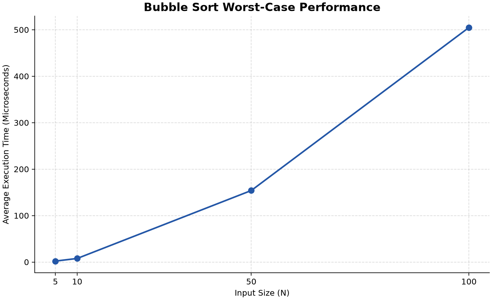

# Empirical Analysis of Sorting Algorithms

**A Python-based performance analysis of Bubble Sort using different input sizes.**

## Overview

This project explores how the execution time of Bubble Sort changes as the input size increases.

The experiment measures sorting performance using high-precision timing, analyzes the results, and compares empirical observations with theoretical time complexity.

## Experiment Details

| Parameter | Description |
|---|---|
| Algorithm | Bubble Sort |
| Language | Python |
| Input Sizes | 5, 10, 50, 100 |
| Test Cases | Worst-case (descending order) |
| Trials | 5 per input size |
| Timer | `time.perf_counter_ns()` |
| Visualization | Matplotlib |

## Performance Visualization

The following graph illustrates the average execution time for each input size.



## Features

- Manual implementation of Bubble Sort.
- Worst-case input generation.
- High-precision execution time measurement.
- Multiple trials and average calculation.
- Automatic CSV results generation.
- Performance visualization using Matplotlib.
- Sorting correctness verification.

## Project Structure

```text
Sorting_Algorithms_Assignment/
│
├── sorting_analysis.py
├── results.csv
├── results_graph.png
├── report.md
├── requirements.txt
├── README.md
└── .gitignore
```

## Getting Started

### Requirements

- Python 3.14.4 or a compatible Python version.
- Matplotlib.

### Installation

Clone the repository:

```bash
git clone YOUR_REPOSITORY_URL
cd Sorting_Algorithms_Assignment
```

Install dependencies:

```bash
python -m pip install -r requirements.txt
```

### Run the Program

```bash
python sorting_analysis.py
```

The program will automatically execute the experiments and generate the results table, CSV file, and performance graph.

## Results

The experiment evaluates how Bubble Sort behaves with increasing input sizes.

The generated results are available in `results.csv`, while the complete methodology and discussion are documented in `report.md`.

## Author

**Mustafa I.M.Hassouna**
**Sap Id: 71601**

Software Engineering Student

This project was developed as part of an academic assignment on algorithm analysis and performance evaluation.