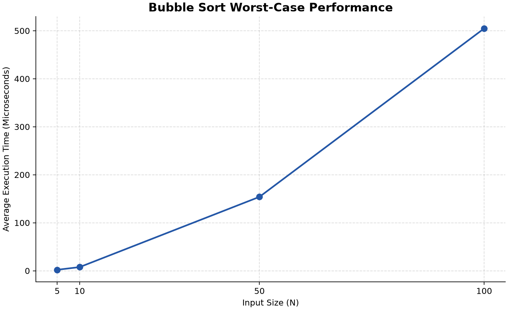

# Empirical Analysis of Sorting Algorithms: Bubble Sort

## 1. Introduction

This report examines Bubble Sort empirically for four small input sizes. Bubble Sort repeatedly compares neighboring values and swaps them when they are out of order. After each pass, the largest remaining value has moved to its final position. The implementation uses an early-exit flag: if a complete pass makes no swaps, sorting is finished.

The assignment supplies ascending arrays containing the integers 1 through 5, 10, 50, and 100. To study worst-case behavior, the program preserves these original arrays and reverses copies of them before measurement. Thus, all measured inputs are descending, while the supplied ascending sequences remain unchanged.

## 2. Methodology

The program runs the hand-written `bubble_sort` function on descending inputs of sizes 5, 10, 50, and 100. Every sorting operation receives a fresh list copy. The copy is created before starting the timer, so reported durations measure the sorting call rather than list-copy preparation. Timing uses Python's `time.perf_counter_ns()`.

Small inputs can take too little time for a single run to measure reliably. For each input size, the script automatically calibrates a repetition count until a batch takes at least 0.10 seconds. It then performs five measurement trials using that repetition count. Each trial result is the sum of the measured sort-call durations divided by the number of operations, converted from nanoseconds to microseconds. The five trial means are averaged to obtain the reported average.

After each sort, the program checks the output against the expected ascending sequence. If an output is wrong, execution stops with an error. The reference sequence is constructed directly from the known input values; Bubble Sort itself is implemented manually.

## 3. Results and Graph

The following values are from the latest actual execution of `sorting_analysis.py`. Individual trial columns in `results.csv` retain six decimal places; the table shows the aggregate mean.

| Array | Input size (N) | Repetitions per trial | Average time (µs) |
|:--|--:|--:|--:|
| Arr1 | 5 | 58,238 | 2.045027 |
| Arr2 | 10 | 10,620 | 7.666814 |
| Arr3 | 50 | 885 | 153.944429 |
| Arr4 | 100 | 218 | 504.770000 |

## 4. Analysis

Average measured time rises overall as the input size increases. The 100-element input takes substantially longer than the 50-element input, consistent with the growth in the number of comparisons and swaps for descending data. The smallest sizes do not form a perfectly smooth curve: the measured mean for N = 10 is relatively close to N = 5 compared with what a simple quadratic scaling estimate might suggest.

This irregularity is expected for such short operations. Timer-call overhead, interpreter and operating-system scheduling, background activity, CPU state, and cache effects can be comparable to the work being measured for very small arrays. Repeated operations and five separate trials reduce the influence of one-off noise, but cannot remove all system variation. Individual trial values in the CSV show this variability directly. Results are specific to the machine and software environment used for the run.

## 5. Theoretical vs. Empirical Complexity

With the early-exit optimization, Bubble Sort has a best-case time complexity of **O(N)**: an already sorted list requires one pass to discover that no swaps are needed. Its average-case and worst-case time complexities are both **O(N²)**. Descending input is worst-case because many adjacent swaps are needed across repeated passes. The algorithm uses **O(1)** auxiliary space because it sorts the given list in place (excluding the input copy used by this measurement harness).

The empirical trend is broadly consistent with the quadratic worst-case expectation: larger descending arrays take longer, with the increase becoming clear at 50 and 100 elements. The measurements are not expected to match an exact quadratic curve at these small sizes. Fixed interpreter and timing overhead matters disproportionately for small N, and only four sizes were measured. The results therefore support the theoretical trend but are not a precise estimate of asymptotic growth.

## 6. Conclusion

The experiment implemented Bubble Sort with early termination and measured it on descending copies of the four assignment arrays. Each result was checked, and five repeated trials were averaged per size. The observed increase in runtime supports the expected O(N²) worst-case behavior, while noise at the smallest sizes illustrates why empirical measurements should be interpreted alongside theoretical analysis. The generated CSV preserves all trial measurements, and the graph visualizes the average times.
